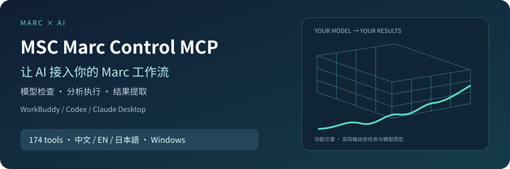

# MSC Marc Control MCP 1.3.2

**Download status:** The 1.3.2 installer is not publicly uploaded yet. It will be published after further development and validation.

**Connect your AI assistant to local Marc/Mentat: inspect inputs, carry out reviewed model operations, and organize solver results.**

[详细中文介绍](README.zh-CN.md) · [日本語](README.ja.md) · [Downloads](https://github.com/WangJ226/MSC-Marc-Control-MCP/releases) · [Getting started](docs/trial-install.md) · [FAQ](docs/faq.md)

**174 tool entries · Three interface languages · Bundled MCP Python · User-approved execution**

[完整功能与调用示例 / Capability guide (中文) →](docs/features.md)

## From a concrete task to inspectable outputs

For researchers, students and engineers already working with Marc/Mentat, repetitive input checks, log inspection and result extraction take time. Use your own WorkBuddy, Codex or Claude Desktop to describe a task, call local MCP tools and inspect their actual results. You define the engineering assumptions and approve operations; the assistant coordinates tool calls; Marc/Mentat performs the corresponding work.

| Task | Implemented capability | Useful outputs |
|---|---|---|
| Connect the environment | Marc discovery, environment checks, client configuration, diagnostics export | Status checks and diagnostic JSON |
| Inspect an existing model | DAT summaries, material/set membership, contact and insert topology, spring and subroutine dependency audits | Structured findings and items to investigate |
| Repeat model operations | Model/set queries, specified loads and constraints, material/geometry updates, job and input creation | Operation results, input files and candidate variants |
| Investigate a solver run | Job launch/tracking, log parsing, progress summaries, hotspot mapping | Run status and diagnostic clues |
| Extract results | T16 histories and extrema, CSV curve analysis, history/path exports and graphics snapshots | Data tables, curves and images supported by each tool |

The application inherits 174 tool entries from its V2.16 baseline. Inputs, output formats and prerequisites vary by tool. Start with a model audit, a failed-run log or an existing result file; review the evidence before approving changes.

## Start with one small task

1. Check [Releases](https://github.com/WangJ226/MSC-Marc-Control-MCP/releases) for available installers. While the public list is empty, [contact the maintainer](docs/contact.md) for access arrangements.
2. Install the EXE and activate with the supplied code. Access follows the issued authorization; experience requests are reviewed manually.
3. Detect Marc, confirm the selected installation and run the environment check.
4. Connect WorkBuddy, Codex or Claude Desktop, reload it and confirm trust.
5. Ask the assistant to call `run_mcp_doctor` first. Select a project copy and approve model changes, application launches and solver runs individually.
6. Review returned status and actual output files; export diagnostics when reporting a problem.

## Requirements and evidence

Bring Windows, a licensed Marc/Mentat installation and your own AI client/account. The MCP Python runtime is bundled. Marc 2016–2025 is the adaptation target range, with 2024/2025 prioritized; individual host/version combinations need validation. Marc installation, organization licensing, AI sign-in and trust prompts remain user steps.

Version 1.3.2 passed 296 external-product automated tests, package audits, online authorization/code protocol checks, three-language window checks and upgrade checks. The packaged EXE passed environment checks and an isolated empty-model Mentat startup/exit on the developer's Windows computer. Protocol simulations are recorded separately. Independent customer Windows, complete workflows in the three AI clients and complex engineering projects still need field evidence. See [version notes](docs/changelog.md).

Models and results stay in local project storage. Content shared with your AI client is subject to that provider's data policy. Review units, boundary conditions, convergence and engineering conclusions yourself.

## Help shape the next iteration

Share your version combination, task, steps and expected/actual result through [Issues](https://github.com/WangJ226/MSC-Marc-Control-MCP/issues). Review and sanitize diagnostic files first; keep codes, account details and private models out of public reports. A Star or a shared small-task experience helps others discover the project.

This repository contains public documentation and release links. Application source is privately maintained.
